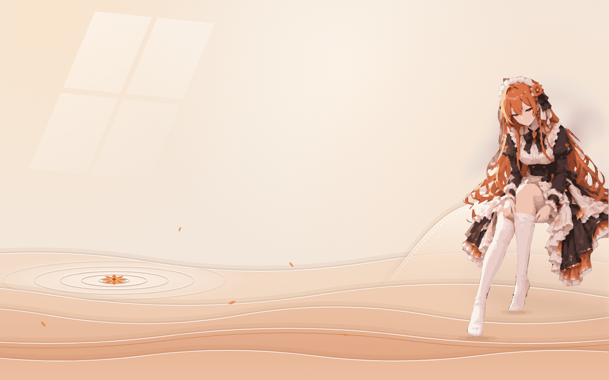

# 女仆小屋主题（maid-room）

给 Claude Code 桌面端换上一套暖色奶油风主题：奶油色底、深棕文字、橙色强调色，右下角一位橙色长发的女仆坐在缀着蕾丝边的软垫上，身后是柔焦的卧室。底部铺着几层剪纸风的波浪，其中走着一道细金线；左下角一朵橙花落在水面上荡开波纹；左上角有窗格投下的淡淡光影。状态栏会显示“女仆小屋 · 慢慢来”。



## 安装

在 Claude Code 的终端会话里输入：

```
/plugin install maid-room --marketplace zbqpassion/Maid-Room-Theme
```

提示添加 marketplace 时输入 `y`，再选择安装范围即可。

## 调节

主题带一个命令 `/maid-room`，设置会跨会话保存：

- `/maid-room veil 0到100`：聊天栏面板的浓度。聊天栏和侧栏是盖在背景上的毛玻璃面板，人物有一部分在聊天栏底下。数字越小人物越清楚，数字越大文字越好读，默认 35。
- `/maid-room image`：改用位图原画做背景，画质是原图水平。部分 App 版本不画图片背景，切过去后如果看不到人物，就切回矢量。
- `/maid-room vector`：切回矢量背景（默认，一定能显示）。
- `/maid-room`：查看当前设置和用法。

## 说明

- 主题只在 Claude Code **桌面端和手机 App** 里绘制，纯终端和编辑器里看不到背景。
- 只有浅色一套：背景是浅色插画，开启后即使系统是深色模式，也会保持浅色。
- 窗口宽度小于 900 像素时，右下角的人物会自动隐藏，避免挡住正文。
- 背景是静态的，不加动画，避免一直占用 CPU。
- 矢量背景里的人物是简化过的：桌面端的背景场景只画矢量图形，整段 SVG 不能超过 131072 字符，原画的细节放不下。
- 卸载：`/plugin uninstall maid-room`。

## 实现

背景是一张纯矢量的 SVG 场景，由 `tools/build_scene.py` 生成到 `hooks/scene.js`：

- `tools/cutout.py` 用 OpenCV GrabCut 把人物从 `tools/source/maid.webp` 里抠出来，得到 `tools/source/mask.png`。
- `tools/trace.py` 把位图描摹成分层矢量路径：k-means 分色，最暗的颜色当底，其余颜色各画自己的区域并只向后画的颜色里外扩，每条边界只画两次；轮廓写成过各边中点的二次曲线，字符数和折线一样，放大后是圆滑的。
- 人物整体精描，脸部另用更高分辨率描一小块叠在上面；房间抹掉人物、模糊、向页面底色渐隐后描成几块色斑，再加模糊滤镜。
- 装饰（波浪、波纹、落花、软垫、窗格光影）直接用矢量画，阴影用错位的半透明描边代替模糊滤镜，绘制开销很小。右下角分三段穿插在装饰之间：房间在最后面，软垫夹在第一层波浪和其余波浪之间，人物在最前面，所以波纹只出现在水面那一层，人物像坐在软垫上、脚踩着波浪。
- `tools/compose_backdrop.py` 合成位图背景 `assets/backdrop.jpg`，给 `/maid-room image` 用。

重新生成（需要 Python 3、Pillow、numpy、opencv-python）：

```
python tools/cutout.py
python tools/build_scene.py
python tools/compose_backdrop.py
python tools/preview.py 效果图.png
```

最后一条不开 App，在本地把场景渲染成一张图，用来检查描摹效果和布局。

人物大小改 `tools/build_scene.py` 里的 `SHOW_H`，上移量改 `LIFT`；配色和状态栏文案在 `hooks/register.tsx` 里修改。

## 致谢

主题的结构和做法参照 [we1jia/blue-whale-theme](https://github.com/we1jia/blue-whale-theme)（MIT），在它的基础上换了插画、配色和描摹算法。

## 许可

代码按 MIT 许可，插画和 `hooks/make-colors.*` 除外，详见 [LICENSE](LICENSE)。
